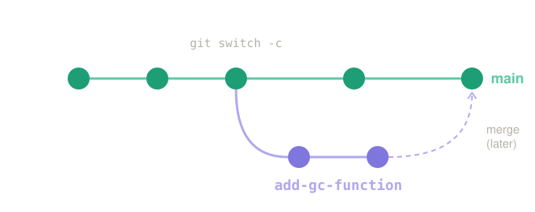

## Warm-up 🔥 {.smaller}

⏱️ 10 min

```bash
git status
git log --oneline
```

How many commits do you have now? Chat the number 🔢

. . .

Seven weeks ago this was your first command. 🙂

::: notes
0–10 min. Celebrate the progress — most will have 15+ commits.
:::

## Two people, one repository 😬

> You edit `seq_functions.py`. Your partner edits `seq_functions.py`.
> Who wins?

. . .

Answer: **nobody has to lose** — that is what branches are for 🌿

::: notes
10–25 min. This block is the foundation of the pair assignment.
:::

## Branches 🌿 {.smaller}

```bash
git branch                    # where am I?
git switch -c add-gc-function # create and go to a new branch
# ... work, add, commit ...
git switch main               # back to the main line
```

. . .

{fig-align="center" width="70%"}

A branch is a **parallel version** of your project. Experiment freely — `main` stays safe. 🛟

::: aside
You'll also see: `git checkout -b add-gc-function` — the older command, same result.
:::

::: notes
Point at the picture: main keeps going, the branch has its own commits, merge comes later (pull requests).
`checkout -b` = `switch -c`. switch was added in Git 2.23 because checkout does too many things.
:::

## Sharing a repository 🤝 {.smaller}

One person owns the repo, the others become **collaborators**.

Today: **I** am the owner, **you** are my collaborators 🙂

. . .

📧 Check your e-mail or [github.com/notifications](https://github.com/notifications) → **Accept invitation**

```bash
git clone https://github.com/squatAndRope/programming-basics.git
cd programming-basics
git pull               # get the newest changes 📥
```

::: {.callout-note}
Golden rule: `git pull` **before** you start working. Every time. 🌅
:::

::: notes
Invitations expire after 7 days. If someone cannot push later, the invitation was not accepted.
:::

## Pull requests 📬

```bash
git push -u origin add-gc-function
```

Then on GitHub: **Compare & pull request**

. . .

A pull request is a **proposal**: "here is my change, please look at it before it goes into `main`" 👀

::: notes
Emphasise: this is exactly how professional teams work, including at my job.
:::

## Code review 👀 {.smaller}

On the **Files changed** tab you can comment on any line.

Good review comments:

- "What happens here if the sequence is empty?" 🤔
- "Could this be a function? It repeats below"
- "Nice — I didn't know about `.get()`" 🎉

. . .

Review is about the **code**, never about the person. 💛

::: notes
Model one good and one bad comment. Online, tone in writing matters even more.
:::

## Exercise: Your first pull request 📬 {.smaller}

⏱️ 30 min · everyone into **my** repository

1. Accept the invitation and **clone** the repo
2. Create your **own branch**: `git switch -c <yourname>-hello`
3. Add **one new file** `students/<yourname>.py` with one small function 🐍
4. `git add` → `git commit` → `git push -u origin <yourname>-hello`
5. On GitHub: **Compare & pull request** → write what your file does
6. Leave **one kind comment** on a classmate's pull request 👀

::: {.callout-warning}
🚫 Never push to `main` directly — only through a pull request.
:::

::: notes
25–55 min. Paste the steps in the chat.
Own file per person = no conflicts today (conflicts are next block).
Expect authentication issues — have the token/gh login plan ready.
Watch the Pull requests tab: count PRs vs. students.
:::

## Live merge 🎉 {.smaller}

⏱️ 10 min · on my screen

I review your pull requests and press **Merge** — one by one 🟢

. . .

Then everybody:

```bash
git switch main
git pull
ls students/
```

Everyone's file is now in your copy. **That** is teamwork with Git 🤝

::: notes
55–65 min. Merge live, read one or two functions aloud, say something nice about each.
If a PR touched something outside students/, show how to ask for changes instead of merging.
:::

## Wrap-up ✅ {.smaller}

| Command | What it does |
|---|---|
| `git clone <url>` | Copy a repo to your computer 📦 |
| `git switch -c name` | New branch 🌿 |
| `git switch main` | Go back |
| `git pull` | Get others' changes 📥 |
| `git push -u origin name` | Publish your branch |

**Next block:** what happens when you both edit the **same line** 💥

::: notes
65–80 min. Leave them curious about conflicts — it is the best part of week 8.
:::
