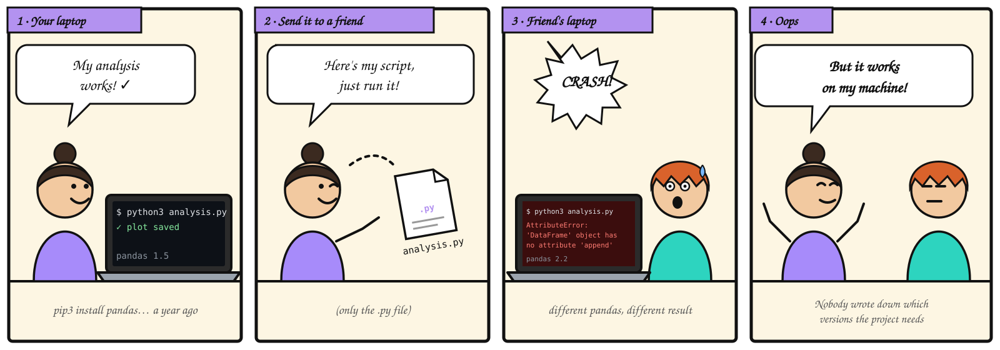
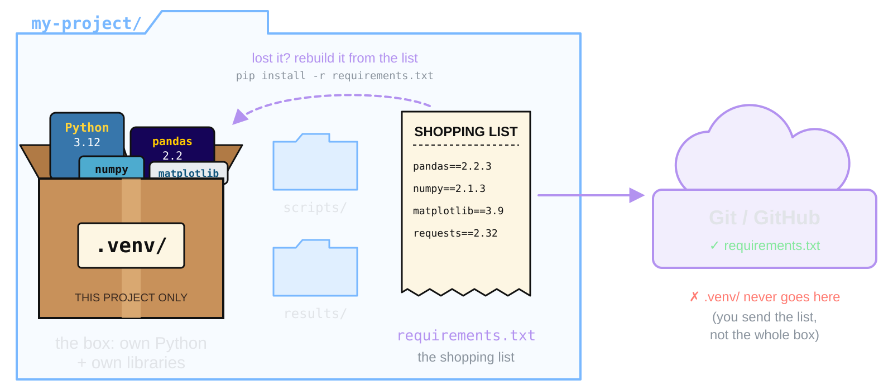
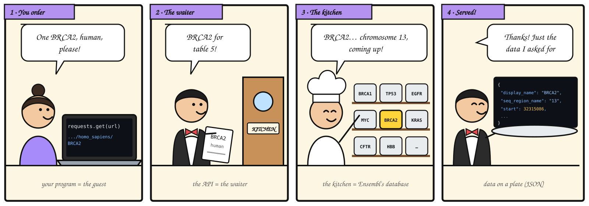

## Warm-up 🔥 {.smaller}

⏱️ 5 min · your browser

Open this link in your browser:

```
https://rest.ensembl.org/lookup/symbol/homo_sapiens/BRCA2?content-type=application/json
```

. . .

In the chat: on which **chromosome** is BRCA2? How long is the gene? 🧬

::: notes
0–5 min. Answer: chromosome 13 (seq_region_name), length = end - start + 1 (both ends count).
They just used an API without writing any code. We come back to this in part 2.
:::

## Today 🗺️ {.smaller}

| Part | Topic | Time |
|---|---|---|
| 1 | 📦 **Virtual environments**: your own clean box for each project | ~25 min |
| 2 | 🌐 **APIs**: getting data straight from biological databases | ~45 min |
| 🐍 | **Bonus: conda**, venv's big sibling | ~10 min |
| ✅ | Commit & push | ~5 min |

. . .

Both are things your **final project** will need 🚀

::: notes
5–7 min. Part 1 first on purpose: in part 2 we install `requests` *inside* a venv.
:::

# Part 1 · Virtual environments 📦

## The problem 😩 {.smaller}

{fig-align="center" width="100%" fig-alt="Four-panel comic: a student's script works on her laptop with pandas 1.5, she sends only the .py file to a friend, it crashes on his laptop with pandas 2.2, and she shrugs: but it works on my machine!"}

. . .

`pip3 install pandas` → installed **for the whole computer** 🌍, and the project doesn't remember **which version** it needs

::: notes
7–10 min. Tell the comic panel by panel, then ask in the chat: has anyone had an install break something before?
Points behind it: project A needs pandas 1.5, project B needs 2.2; code runs on one laptop and crashes on another;
after a year you don't remember what you installed.
DataFrame.append really was removed in pandas 2.0 (use pd.concat), so the error in panel 3 is real.
:::

## The solution: a virtual environment 📦 {.smaller}

A **box inside your project** with its own Python and its own libraries.

{fig-align="center" width="100%" fig-alt="Diagram: the my-project folder holds a cardboard box labelled .venv with Python 3.12, pandas 2.2, numpy and matplotlib inside, plus scripts/ and results/ folders and a requirements.txt shopping list. A dashed arrow rebuilds the box from the list with pip install -r requirements.txt. Only requirements.txt goes to Git/GitHub; .venv never does."}

. . .

One project = one `.venv` ✅

::: notes
10–12 min. Walk through the picture: the box (.venv) holds this project's Python and libraries,
the shopping list (requirements.txt) says what goes in the box.
Delete the box anytime, rebuild it from the list. The list goes to Git, the box stays on your computer.
Analogy: you don't send the fridge to a friend, you send the shopping list.
:::

## Create and activate 🛠️ {.smaller}

In the terminal, **inside your project folder**:

```bash
python3 -m venv .venv          # create the box (once)
```

. . .

:::: {.columns}
::: {.column width="50%"}
🍎 🐧 **macOS / Linux**

```bash
source .venv/bin/activate
```
:::
::: {.column width="50%"}
🪟 **Windows (PowerShell)**

```powershell
.venv\Scripts\Activate.ps1
```
:::
::::

. . .

It worked if your prompt starts with **`(.venv)`** 🎉

```bash
(.venv) $ which python      # Windows: where python
/.../my-project/.venv/bin/python
```

::: notes
12–16 min. Live demo. Windows: if PowerShell blocks the script, run once:
Set-ExecutionPolicy -Scope CurrentUser RemoteSigned
On Windows the command may be `python` instead of `python3`.
VS Code: Ctrl/Cmd+Shift+P → "Python: Select Interpreter" → pick .venv.
:::

## Install, save, rebuild 🧾 {.smaller}

```bash
(.venv) $ pip install requests pandas matplotlib   # only into this box
(.venv) $ pip freeze > requirements.txt            # write the shopping list
```

. . .

Someone else (or you, on a new laptop) gets your repo:

```bash
python3 -m venv .venv
source .venv/bin/activate
pip install -r requirements.txt     # same libraries, same versions ✅
```

. . .

Done for today? `deactivate` 👋

::: notes
16–19 min. Inside an active venv `pip` and `python` point to the box, no need for pip3/python3.
Show requirements.txt content: package==version lines.
:::

## Keep the box out of Git 🙈 {.smaller}

`.venv` is big (thousands of files) and specific to your computer.

Add it to **`.gitignore`**:

```
.venv/
__pycache__/
```

. . .

| Goes to Git 💾 | Stays local 💻 |
|---|---|
| `scripts/`, `README.md` | `.venv/` |
| `requirements.txt` | `__pycache__/` |

::: notes
19–20 min. Check with `git status`: .venv must not show up.
:::

## Exercise 1/2: build the box 📦 {.smaller}

⏱️ 10 min (both slides) · on your own · react ✅ when done

Open a terminal **in your repo folder**, then type line by line:

```bash
mkdir venv-practice                     # 1. a new folder for today
cd venv-practice                        # 2. go inside
python3 -m venv .venv                   # 3. create the box
source .venv/bin/activate               # 4. → (.venv) in the prompt? Windows: .venv\Scripts\Activate.ps1
pip install requests pandas matplotlib  # 5. fill the box
pip freeze > requirements.txt           # 6. write the shopping list
```

. . .

In **VS Code**, inside `venv-practice/`, create two files:

:::: {.columns}
::: {.column width="35%"}
7\. **`.gitignore`**

```
.venv/
```
:::
::: {.column width="65%"}
8\. **`check.py`**

```python
import pandas, requests, matplotlib
print("pandas", pandas.__version__)
print("All libraries found ✅")
```
:::
::::

::: notes
~6 min. Windows: `python` instead of `python3`; if PowerShell blocks activation:
Set-ExecutionPolicy -Scope CurrentUser RemoteSigned
Common issues: mkdir in the home folder instead of the repo, (.venv) missing → pip installs globally again.
Create the files in VS Code, not with echo (PowerShell echo writes UTF-16, Git can't read that .gitignore).
:::

## Exercise 2/2: test it and save it to Git 💾 {.smaller}

Still in `venv-practice/`, with **`(.venv)`** in the prompt:

```bash
python3 check.py                        # 9. prints pandas version + ✅
git status                              # 10. .venv/ must NOT be listed
cd ..                                   # 11. back to your repo folder
git add venv-practice
git commit -m "Add venv practice"       # 12. save it
git push                                # 13. your partner needs it next!
```

. . .

On GitHub, `venv-practice/` should have **3 files**: `.gitignore`, `check.py`, `requirements.txt`, and **no** `.venv/` ✅

::: notes
~4 min. If .venv shows up in git status: .gitignore is in the wrong folder or has a typo.
If .venv was already committed: git rm -r --cached venv-practice/.venv
The venv stays active after cd .., so part 2 (APIs) works from the repo root with the same box.
Push matters: the next exercise clones this repo.
:::

## Exercise: swap boxes 🔁 {.smaller}

⏱️ 10 min · breakout rooms · pairs · react ✅ when **both** are done

**Owner** 🏠: `git push`, then paste your repo URL in the room chat

**Guest** 🧳: rebuild the owner's box on **your** laptop, step by step:

```bash
cd ..                                   # 1. leave your own repo!
git clone <OWNER_URL> friend-repo       # 2. copy the owner's project
cd friend-repo/venv-practice
ls -a                                   # 3. list + check.py, but no .venv ✅
python3 -m venv .venv                   # 4. build an empty box
source .venv/bin/activate               # 5. Windows: .venv\Scripts\Activate.ps1
pip install -r requirements.txt         # 6. fill it from the shopping list
python3 check.py                        # 7. same pandas version as the owner?
```

✅ Post in the room chat: *"pandas X.Y.Z, works on my machine too!"* → then **swap roles** 🔄

::: notes
~10 min. Pure practice, no thinking needed: they just follow the steps. Same repo as the previous exercise.
Repos are public (final project rule), so cloning needs no invite.
Step 3 is the point: .venv is NOT in the clone, only requirements.txt; the guest builds the box themselves.
Common issues: cloning inside their own repo (forgot cd ..), owner forgot to push requirements.txt,
owner forgot step 13 (push), "friend-repo" already exists on the second round (use friend-repo2), venv not activated before pip install.
Windows: `python` instead of `python3`, `ls -Force` instead of `ls -a`.
On the swap the new owner already pushed in exercise 2/2, so they only paste the URL.
friend-repo is just a copy, they can delete it afterwards.
:::

# Part 2 · Data from the internet 🌐

## An API is a waiter 🍽️ {.smaller}

{fig-align="center" width="100%" fig-alt="Four-panel comic: a student with a laptop orders one human BRCA2; a waiter (the API) takes the order to the kitchen; a chef in Ensembl's kitchen picks the BRCA2 jar from a shelf of gene jars; the waiter serves the data on a plate as JSON."}

. . .

You don't walk into the kitchen: you **order** with a URL and get **just the data** back 🧬

::: notes
~2 min. Tell it panel by panel. The menu would be the API docs: it says what you can order.
Then the next slide shows how the order (the URL) is written.
:::


## What is an API? 🌐 {.smaller}

A **web page** is made for humans 👀

An **API** is a URL made for **programs** 🤖, and it returns *data*, not a layout.

. . .

```
https://rest.ensembl.org / lookup/symbol / homo_sapiens / BRCA2
        server              what to do      species       gene
```

. . .

Big biological databases all have one: Ensembl, NCBI, UniProt, PDB… 🧬

::: notes
27–30 min. Read the URL as a sentence. Change BRCA2 to TP53 in the browser live.
:::

## Where to find biological data 🧬 {.smaller}

| Database | What you find there | API docs |
|---|---|---|
| **Ensembl** 🧬 | genes, transcripts, sequences, variants, orthologs, for hundreds of species | [rest.ensembl.org](https://rest.ensembl.org) |
| **NCBI** 📚 | GenBank sequences, genes, PubMed articles, sequencing runs (SRA) | [E-utilities](https://www.ncbi.nlm.nih.gov/books/NBK25501/) |
| **UniProt** 🧪 | proteins: sequence, function, domains, where in the cell | [uniprot.org/help/api](https://www.uniprot.org/help/api) |
| **PDB** 🔬 | experimental 3D structures of proteins and DNA | [RCSB web APIs](https://www.rcsb.org/docs/programmatic-access/web-apis-overview) |
| **AlphaFold DB** 🤖 | predicted 3D structures for almost every known protein | [alphafold.ebi.ac.uk/api-docs](https://alphafold.ebi.ac.uk/api-docs) |
| **KEGG** 🗺️ | metabolic and signalling pathways, which genes take part | [KEGG REST](https://www.kegg.jp/kegg/rest/keggapi.html) |

. . .

Same idea everywhere: **a URL in → data out** (JSON, FASTA or a table) 🔁

::: notes
~2 min, don't go through every row. Point out: these are good data sources for the final project.
Today we only use Ensembl.
:::

## JSON = dictionaries you already know 📖 {.smaller}

What you saw in the browser:

```json
{
  "id": "ENSG00000139618",
  "display_name": "BRCA2",
  "biotype": "protein_coding",
  "seq_region_name": "13",
  "start": 32315086,
  "end": 32400268,
  "strand": 1
}
```

. . .

Keys and values → a Python **dictionary** (week 6!) 🎯

::: notes
32–34 min. Values shortened, the real response has more keys (description, assembly_name, …).
:::

## Asking from Python 🐍 {.smaller}

`requests` is already in your box from part 1 📦 (`(.venv)` active?)

```python
import requests

url = "https://rest.ensembl.org/lookup/symbol/homo_sapiens/BRCA2"
response = requests.get(url, headers={"Content-Type": "application/json"})
response.raise_for_status()      # stop with an error if something went wrong

gene = response.json()           # JSON → dictionary
print(gene["display_name"], gene["seq_region_name"])
print("Length:", gene["end"] - gene["start"] + 1, "bp")
```

. . .

`ModuleNotFoundError: requests`? → your venv is **not active** 😉

::: notes
34–39 min. Show what happens with a typo in the gene name: raise_for_status() gives an HTTPError (400).
Same idea as FileNotFoundError: the outside world can fail.
Deactivate on purpose and run again to show the ModuleNotFoundError.
:::

## Many genes → a table 📋 {.smaller}

The bridge from last week: **list of dictionaries → DataFrame** 🪄

```python
import pandas as pd
import requests

genes = ["BRCA1", "BRCA2", "TP53", "EGFR", "MYC"]
rows = []

for symbol in genes:
    url = f"https://rest.ensembl.org/lookup/symbol/homo_sapiens/{symbol}"
    r = requests.get(url, headers={"Content-Type": "application/json"})
    r.raise_for_status()
    g = r.json()
    rows.append({"gene": symbol, "chromosome": g["seq_region_name"],
                 "length": g["end"] - g["start"] + 1})

df = pd.DataFrame(rows)
df.to_csv("results/genes.csv", index=False)     # save it! 💾
```

::: notes
39–44 min. Every piece is something they know: loop (w5), dict (w6), list of dicts → DataFrame (w9), to_csv (w9).
:::

## Be a polite client 🙏 {.smaller}

- **Save** what you downloaded → work on the CSV, not the API 💾
- Don't ask 10 000 times in a loop: there are rate limits ⏳
- Add a small pause if you ask many times: `time.sleep(0.2)`
- No internet = your analysis still runs from the saved file ✅

. . .

> Download once, analyse many times. 🔁

::: notes
44–46 min. Important for the project and the oral exam: their tool must run without the network.
:::

## Exercise: fetch the genes 🌐 {.smaller}

⏱️ 10 min · breakout rooms · pairs · react ✅ · file: **`scripts/fetch_genes.py`**

```python
genes = ["BRCA1", "BRCA2", "TP53", "EGFR", "MYC", "KRAS", "CFTR", "HBB"]
url = f"https://rest.ensembl.org/lookup/symbol/homo_sapiens/{symbol}"   # inside the loop
```

:::: {.columns}
::: {.column width="50%"}
1. Loop over `genes`, request each `url` with
   `headers={"Content-Type": "application/json"}`
2. Keep the 4 columns from the table →
3. Save to **`results/genes.csv`** (`index=False`)

✅ Check: **8 rows** + header
:::
::: {.column width="50%"}
| column | from JSON |
|---|---|
| `gene` | your symbol |
| `chromosome` | `seq_region_name` |
| `length` | `end - start + 1` |
| `strand` | `strand` (1 / -1) |
:::
::::

::: notes
46–56 min. "Many genes → a table" slide plus one extra column (strand).
Common issues: venv not active (ModuleNotFoundError), forgetting the header (HTML/error),
typo in a key → KeyError, results/ missing → OSError.
If Ensembl is slow or down: paste a ready genes.csv in the chat.
:::

# Part 3 · Bonus: conda 🐍📦

## You asked: what about conda? 🙋 {.smaller}

**conda** = a venv **and** a package installer in one tool

. . .

| | `venv` + `pip` 📦 | `conda` 🐍 |
|---|---|---|
| Comes with | Python itself | separate install (Miniforge) |
| Installs | Python packages only | **anything**: Python, R, C tools, even Python itself |
| Box lives | in the project (`.venv/`) | in one central place, chosen by **name** |
| Shopping list | `requirements.txt` | `environment.yml` |

. . .

Why bioinformaticians love it: **bioconda** has 10 000+ tools ready to install 🧬
(`samtools`, `bwa`, `blast`, `fastqc`, … no compiling!)

::: notes
~3 min. venv is enough for pure Python projects (and for the final project).
conda shines when you need non-Python tools, or a specific Python version.
Install Miniforge (github.com/conda-forge/miniforge), not the full Anaconda:
small, uses the free conda-forge channel by default. Anaconda's default channel has licence terms for organisations.
mamba is a faster drop-in replacement; recent conda uses the same fast solver anyway.
:::

## Same steps, other words 🔁 {.smaller}

| What | venv 📦 | conda 🐍 |
|---|---|---|
| create the box | `python3 -m venv .venv` | `conda create -n genes python=3.12` |
| step into it | `source .venv/bin/activate` | `conda activate genes` |
| fill it | `pip install pandas` | `conda install -c conda-forge pandas` |
| write the list | `pip freeze > requirements.txt` | `conda env export --from-history > environment.yml` |
| rebuild it | `pip install -r requirements.txt` | `conda env create -f environment.yml` |
| step out | `deactivate` | `conda deactivate` |
| list boxes | `ls -a` 🙂 | `conda env list` |

. . .

Prompt shows **`(genes)`** instead of `(.venv)` ✅

::: notes
~3 min. Same mental model as part 1: box + shopping list, list goes to Git, box doesn't.
--from-history keeps only what you asked for, so the file works on other operating systems too.
conda envs live outside the project folder, so nothing to add to .gitignore.
:::

## A real bioinformatics box 🧬 {.smaller}

`environment.yml`, the shopping list, goes to Git 💾

```yaml
name: genes
channels:
  - conda-forge
  - bioconda
dependencies:
  - python=3.12
  - pandas
  - requests
  - samtools        # not a Python package, conda installs it anyway 🤯
  - r-base          # R too!
```

```bash
conda env create -f environment.yml
conda activate genes
samtools --version
```

. . .

⚠️ Don't mix: inside a conda box use `conda install` first, `pip` only if conda doesn't have it

::: notes
~3 min. No exercise, it's a bonus. Optional homework: install Miniforge and build this box.
Channel order matters: conda-forge before bioconda (bioconda's own recommendation).
Windows: bioconda tools are Linux/macOS only, use WSL or the course server.
:::

## Wrap-up 🎁 {.smaller}

:::: {.columns}
::: {.column width="50%"}
📦 **Virtual environments**

- one `.venv` per project
- `requirements.txt` → Git
- `.venv/` → `.gitignore`
- need non-Python tools? → **conda** 🐍
:::
::: {.column width="50%"}
🌐 **APIs**

- URL in → JSON out → dict
- `requests` + `raise_for_status()`
- download once, analyse many times
:::
::::

. . .

**Commit & push** 💾 `fetch_genes.py`, `results/`, `requirements.txt`

::: notes
66–75 min. Quick round in the chat: one thing that clicked, one thing still confusing.
Remaining minutes: buffer / help with stuck venvs.
:::
